<a href="https://www.linkedin.com/in/gustavolendimuth/">
  <picture>
    <source media="(prefers-color-scheme: dark)" srcset="card-dark.svg">
    
  </picture>
</a>

  <samp>
    <a href="https://www.linkedin.com/in/gustavolendimuth/">linkedin</a> ·
    <a href="mailto:gustavolendimuth@gmail.com">email</a> ·
    <a href="https://apoia.se">apoia.se</a>
  </samp>

## Now

- **[APOIA.se](https://apoia.se)** — Recurring crowdfunding, where supporters back creators every month. I work on the Node.js/MongoDB monolith and the AWS Lambda services around it.
  - Rebuilt the integrations layer as one connector per app. Spotify moved first; Telegram and Discord plug in without touching the controller.
  - Exclusive Telegram groups for paying supporters: Bot API, fail-closed webhooks, SQS with a DLQ alarm, and sign-in with Telegram over OIDC/PKCE.
  - Docker Compose setups for the monolith and the services monorepo, so a change gets checked locally before it reaches staging.
- **Mútua** — Volunteering for a cooperative farmers' market. Built the assistant that turns WhatsApp messages into orders (Pydantic AI, Meta Cloud API, Celery).

## Side projects

- **[compra-coletiva](https://github.com/gustavolendimuth/compra-coletiva)** — Group buying, end to end. Weight-based shipping, Socket.IO chat, BullMQ emails, LGPD compliance tests in CI.
- **[its-done](https://github.com/gustavolendimuth/its-done)** — Time tracking and invoicing. Turborepo, NestJS, Next.js, Prisma, and a public portal where clients see their own invoices.
- **[transcritor](https://github.com/gustavolendimuth/transcritor)** — Audio and video to text with Whisper. Uploads are deleted the moment the job ends.
- **[guia-claude-code-otimizacao](https://github.com/gustavolendimuth/guia-claude-code-otimizacao)** — A PT-BR guide to installing Claude Code and tuning Windows for it.

## Things I care about

- Spec before code. I write the spec and the repo context; coding agents build on it; an independent check runs before the PR.
- Types from the database to the screen, tests that fail for a reason, and Docker that comes up on the first try.
- READMEs a stranger can follow.
- Remote-first and fluent in English, after four years living in London.

 

<b>🇧🇷 Em português</b>

 

Desenvolvedor full stack. Construo APIs, integrações e serviços em nuvem para uma plataforma que as pessoas pagam todo mês.

**Agora**

- **[APOIA.se](https://apoia.se)**: financiamento coletivo recorrente, em que apoiadores mantêm apoios mensais a criadores. Trabalho no monolito em Node.js/MongoDB e nos serviços em AWS Lambda ao redor dele.
  - Refiz a camada de integrações com um connector por app. O Spotify migrou primeiro; Telegram e Discord entram sem mexer no controller.
  - Grupos exclusivos do Telegram para apoiadores pagantes: Bot API, webhook fail-closed, SQS com alarme na DLQ e login com o Telegram via OIDC/PKCE.
  - Ambiente Docker Compose para o monolito e para o monorepo de serviços, para validar a mudança localmente antes de chegar em staging.
- **Mútua**: voluntário numa plataforma de feiras de produtores em cooperativas. Fiz o assistente que transforma mensagens de WhatsApp em pedidos (Pydantic AI, Meta Cloud API, Celery).

**Projetos pessoais**

- **[compra-coletiva](https://github.com/gustavolendimuth/compra-coletiva)**: compra coletiva de ponta a ponta. Frete pelo peso, chat em Socket.IO, e-mails no BullMQ, testes de LGPD no CI.
- **[its-done](https://github.com/gustavolendimuth/its-done)**: controle de horas e faturamento. Turborepo, NestJS, Next.js, Prisma e um portal onde o cliente vê as próprias faturas.
- **[transcritor](https://github.com/gustavolendimuth/transcritor)**: áudio e vídeo para texto com Whisper. O arquivo é apagado assim que a transcrição termina.
- **[guia-claude-code-otimizacao](https://github.com/gustavolendimuth/guia-claude-code-otimizacao)**: guia para instalar o Claude Code e preparar o Windows para ele.

**O que importa pra mim**

- Spec antes do código. Escrevo a spec e o contexto do repositório, os agentes de código trabalham em cima disso, e uma verificação independente roda antes do PR.
- Tipagem do banco até a tela, testes que falham por um motivo e Docker que sobe na primeira tentativa.
- README que alguém de fora consegue seguir.
- Trabalho remoto e em inglês sem dificuldade, depois de quatro anos morando em Londres.

